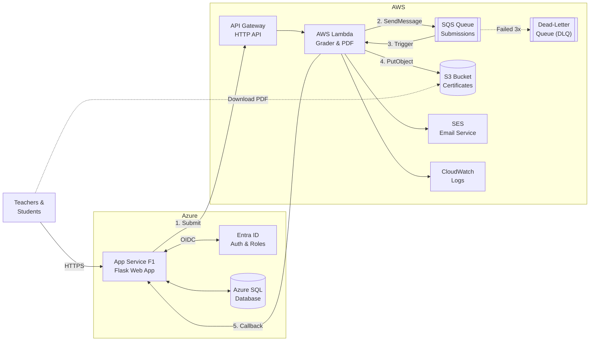

# QuizCloud: Multi-Cloud Online Quiz System (Azure + AWS)

A distributed quiz platform split across Azure and AWS. Teachers create quizzes, students submit answers, and grading runs asynchronously in the background.

When a student submits, the web app queues the submission into **Amazon SQS**. An **AWS Lambda** function grades the submission, renders a **PDF certificate**, stores it in an **S3 bucket**, and returns a **presigned URL**. Authentication and role management (Teacher / Student) run on **Microsoft Entra External ID**, while persistent application data lives in **Azure SQL Database**.

> Quick local run without any cloud account: check out [Local Demo](#running-the-demo-locally).

---

## Architecture



### Asynchronous Submission Flow

1. The web service stores student answers in Azure SQL with a `pending` status, then passes `action: submit` to AWS API Gateway.
2. Lambda verifies the shared secret, pushes the payload to **SQS**, and returns `202 queued` immediately. The student sees a live-polling status page.
3. SQS triggers Lambda to grade the answers and build the PDF certificate using `fpdf2`.
4. Lambda uploads the finished PDF to Amazon S3.
5. Lambda posts the final grade back to the web app (`POST /api/grader/callback`). The web app records the grade in Azure SQL, and Lambda dispatches an email via SES.

If the callback fails, SQS retries up to 3 times before routing the job to a dead-letter queue. Submissions pending for over two minutes show a manual **Regrade** button.

Decoupling the frontend from grading prevents connection exhaustion when an entire class submits at the deadline. Lambda avoids connecting to Azure SQL directly, so there is no need for ODBC drivers inside Lambda or opening SQL firewall rules to arbitrary public IPs.

---

## Features

| Role | Capabilities |
|---|---|
| **Teachers** | Create and delete quizzes, set timers and passing thresholds, configure single/multiple choice questions, import questions from CSV, open/close exams, view overall stats (average, high/low, pass rate), and export printable HTML reports or CSV summaries. |
| **Students** | Browse active exams, take timed quizzes with auto-submit on expiry, inspect question-by-question breakdowns, download signed PDF certificates (or report cards), and receive email summaries. |
| **System** | Role-based access control via Entra App Roles, CSRF protection, strict submission ownership checks, asynchronous SQS processing with automatic retries, and dead-letter queue inspection. |

---

## Repository Structure

```
.
├── README.md
├── run_demo.bat / run_demo.command / run_demo.sh   # Run local demo with one click
├── reset_demo.bat                                  # Wipe demo SQLite data (Windows)
├── requirements-local.txt                          # Dependencies for local testing
├── web/                    # Flask app running on Azure App Service
│   ├── app.py              # Application routes (teacher, student, grading callback)
│   ├── auth.py             # Microsoft Entra External ID (MSAL) and dev mock auth
│   ├── models.py           # Database schema (Azure SQL / SQLite)
│   ├── grader_client.py    # Client calling AWS API Gateway (submit / grade / presign)
│   ├── config.py, demo_data.py, requirements.txt
│   ├── static/app.css
│   └── templates/
├── grader/                 # Serverless grading worker running on AWS Lambda
│   ├── handler.py          # Entry point for API Gateway and SQS triggers
│   ├── service.py, grading.py, certificate.py
│   ├── fonts/              # Unicode fonts for UTF-8 PDF rendering
│   ├── requirements.txt
│   └── build_zip.sh        # Packaging script for Lambda zip deployment
└── tests/                  # Automated pytest suite
```

---

## Running the Demo Locally

Requires **Python 3.10+**. You do not need an Azure or AWS account to test.

| Platform | Command / Action |
|---|---|
| **Windows** | Double-click `run_demo.bat` |
| **macOS** | Double-click `run_demo.command` (Right-click → Open the first time) or run `./run_demo.sh` |
| **Linux** | Run `./run_demo.sh` |

The launcher script sets up a virtual environment in `.venv`, installs requirements, seeds sample quizzes and submissions, and opens `http://127.0.0.1:5000`.

The login screen provides quick dev-mode buttons for both Teacher and Student accounts. Preloaded data includes 3 exams and 9 graded submissions. To reset everything back to scratch, run `reset_demo.bat` (Windows) or `./run_demo.sh --reset`.

In demo mode, grading runs in-process using the same Python logic as Lambda, and certificates are saved locally to `web/instance/certificates/`.

---

## Local Development & Tests

```bash
# Set up environment
python3 -m venv .venv
source .venv/bin/activate    # On Windows: .venv\Scripts\activate
pip install -r web/requirements.txt -r grader/requirements.txt pytest boto3

# Run test suite
python -m pytest -q tests

# Initialize local SQLite database with test data and launch
cd web
flask --app app init-db --demo
flask --app app run          # Serves on http://localhost:5000
```

---

## Cloud Deployment

Deploy Azure to `Southeast Asia` and AWS to `ap-southeast-1` (Singapore) to keep inter-cloud latency low. Both clouds offer free tiers suitable for student projects. Set up budget alerts ($1) to prevent surprises.

### 1. AWS Setup

1. **S3 Bucket:** Create a private bucket (e.g. `quizcloud-certs-<group>`). Keep *Block all public access* turned on.
2. **SQS Queues:** Create two standard queues:
   - `quizcloud-grading-dlq` (default settings).
   - `quizcloud-grading`: set visibility timeout to **180 seconds**. Enable dead-letter queue, link `quizcloud-grading-dlq`, and set *Maximum receives* to **3**. Note the queue URL and ARN.
3. **Lambda IAM Role:** Attach standard policies `AWSLambdaBasicExecutionRole` and `AWSLambdaSQSQueueExecutionRole`. Add an inline policy granting S3, SQS, and SES permissions:
   ```json
   {
     "Version": "2012-10-17",
     "Statement": [
       {"Effect": "Allow", "Action": ["s3:PutObject", "s3:GetObject"], "Resource": "arn:aws:s3:::<BUCKET>/certificates/*"},
       {"Effect": "Allow", "Action": "sqs:SendMessage", "Resource": "<ARN_OF_QUIZCLOUD_GRADING>"},
       {"Effect": "Allow", "Action": "ses:SendEmail", "Resource": "*"}
     ]
   }
   ```
4. **Lambda Function:** Runtime Python 3.12 (x86_64). Package `grader/` using `grader/build_zip.sh` and upload. Set handler to `handler.lambda_handler`, memory to 512 MB, timeout to 30s. Configure environment variables:

   | Name | Value |
   |---|---|
   | `CERT_BUCKET` | S3 bucket name |
   | `GRADER_SECRET` | Shared secret string (shared with web app) |
   | `GRADING_QUEUE_URL` | URL of `quizcloud-grading` |
   | `WEB_CALLBACK_URL` | `https://<your-app>.azurewebsites.net/api/grader/callback` |
   | `SES_SENDER` | (Optional) Verified SES email address |
   | `PRESIGN_TTL_SECONDS` | `3600` |
   | `WEB_CRON_URL` | (Optional) Defaults to `WEB_CALLBACK_URL` with `/api/cron/finalize` |

5. **SQS Trigger:** In the Lambda console, add an SQS trigger pointing to `quizcloud-grading` with **Batch size = 1**.
6. **API Gateway:** Create an HTTP API with a Lambda integration pointing to your function. Add route `POST /grade`. The complete endpoint URL becomes `GRADER_URL`.
7. **SES:** Verify sender and test recipient emails if testing SES from sandbox mode.
8. **EventBridge schedule:** In EventBridge Scheduler, create a recurring schedule (`rate(15 minutes)`) that invokes the same Lambda function. The Lambda then calls `POST /api/cron/finalize` on the web app (derived from `WEB_CALLBACK_URL`; override with `WEB_CRON_URL`), which expires abandoned attempts and picks the best attempt for students who missed an exam's choose-by deadline. The same work also runs whenever a page touches those attempts, so a missed run only delays certificates.

Verify the endpoint with curl:
```bash
curl -X POST "$GRADER_URL" \
  -H "x-grader-secret: $GRADER_SECRET" \
  -H "Content-Type: application/json" \
  -d '{"action":"grade","submission_id":1,"student":{"name":"Test"},"exam":{"id":1,"title":"Test","pass_percent":50},"questions":[{"id":1,"points":1,"correct":[0]}],"answers":{"1":[0]}}'
```

---

### 2. Azure Setup

#### Microsoft Entra External ID
1. In the Microsoft Entra admin center, create an external tenant.
2. Under **App registrations**, register a new application. Set Web Redirect URI to `https://<app>.azurewebsites.net/auth/callback` and generate a client secret.
3. Under **App roles**, declare two roles with values `Teacher` and `Student`.
4. Create a sign-up/sign-in user flow with email authentication, then assign your application to the flow.
5. In **Enterprise applications**, assign users to `Teacher` or `Student`. Users without an assigned role will see an access-denied page.
6. Authority format: `https://<tenant-subdomain>.ciamlogin.com/<tenant-subdomain>.onmicrosoft.com`

#### Azure SQL Database
1. Create a database using the free serverless offer.
2. In networking settings, turn on *Allow Azure services* and whitelist your current IP address.
3. Run the schema creation script from your development machine:
   ```bash
   cd web
   DATABASE_URL='mssql+pymssql://<user>:<password>@<server>.database.windows.net:1433/<db>' flask --app app init-db
   ```

#### Azure App Service
Deploy `web/` to a Linux App Service plan (Free F1, Python 3.12):
```bash
cd web
az webapp up --name <app-name> --runtime PYTHON:3.12 --sku F1 --location southeastasia
az webapp config set --name <app-name> --resource-group <rg-name> --startup-file "gunicorn --bind=0.0.0.0 --timeout 120 app:app"
```

Configure Application Settings:

| Key | Description / Value |
|---|---|
| `SECRET_KEY` | Long random session secret |
| `DATABASE_URL` | Azure SQL connection string (`mssql+pymssql://...`) |
| `AUTH_MODE` | `entra` (or `dev` for initial connectivity checks) |
| `ENTRA_CLIENT_ID` | Client ID from Entra registration |
| `ENTRA_CLIENT_SECRET` | Secret from Entra registration |
| `ENTRA_AUTHORITY` | Entra tenant authority URL |
| `GRADER_URL` | AWS API Gateway endpoint URL |
| `GRADER_SECRET` | Matching shared secret configured on Lambda |
| `GRADER_ASYNC` | `true` (enables SQS async processing) |
| `SCM_DO_BUILD_DURING_DEPLOYMENT` | `true` |

Recommended rollout sequence: deploy with `AUTH_MODE=dev`, hook up `DATABASE_URL`, plug in `GRADER_URL` synchronously, switch `GRADER_ASYNC=true`, and finally enable `AUTH_MODE=entra`.

---

## Grader API Specification

Every request sent to `POST GRADER_URL` must include the `x-grader-secret` header.

| `action` | Extra Body Fields | Response |
|---|---|---|
| `submit` | Submission payload | `202 {"status": "queued", "message_id": "..."}` (grades delivered via callback) |
| `grade` | Submission payload | `200` with score and `certificate_url` (synchronous) |
| `presign` | `certificate_key` | `{"certificate_url": "..."}` |

### Submission Payload Example

```json
{
  "submission_id": 7,
  "student": {"name": "Alex Smith", "email": "alex@school.edu"},
  "exam": {"id": 3, "title": "Cloud Architecture", "pass_percent": 50},
  "questions": [
    {"id": 1, "points": 1, "correct": [1]},
    {"id": 2, "points": 2, "correct": [0, 2]}
  ],
  "answers": {
    "1": [1],
    "2": [0, 2]
  }
}
```

### Callback Payload (AWS Lambda → Azure Web App)

Sent to `POST WEB_CALLBACK_URL` with the `x-grader-secret` header:

```json
{
  "submission_id": 7,
  "score": 3,
  "max_score": 3,
  "percent": 100,
  "passed": true,
  "details": [],
  "certificate_id": "74037BA453",
  "certificate_key": "certificates/exam-3/submission-7-74037BA453.pdf"
}
```

Multiple-choice grading requires all correct options to be selected with no extraneous choices.

---

## Cloud Services Summary

- **Microsoft Azure:** Microsoft Entra External ID, App Service (Linux F1), Azure SQL Database.
- **Amazon Web Services (AWS):** API Gateway (HTTP API), AWS Lambda (Python 3.12), Simple Queue Service (SQS + DLQ), Simple Storage Service (S3), Simple Email Service (SES), CloudWatch Logs, IAM.
