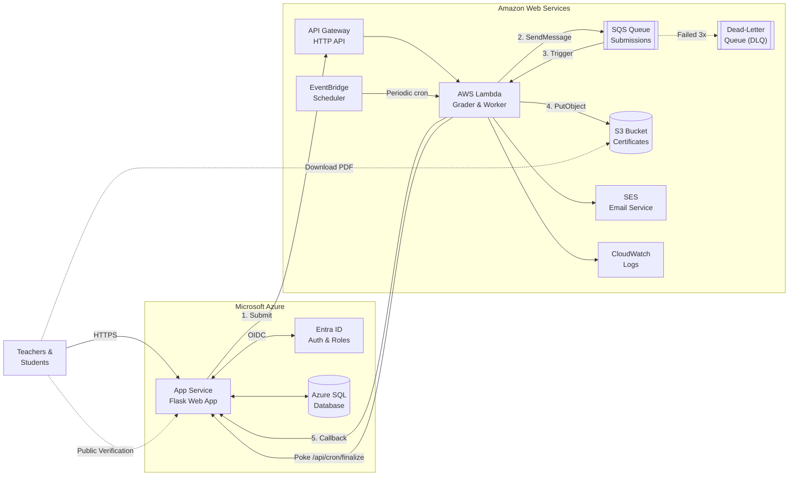

# QuizCloud: Multi-Cloud Online Quiz System (Azure + AWS)

A resilient online examination and quiz platform distributed across Microsoft Azure and Amazon Web Services (AWS). Teachers design exams with strict anti-cheating policies, students take timed tests, and background grading executes serverlessly.

When a student submits, the web app pushes the payload into **Amazon SQS**. An **AWS Lambda** worker grades the submission, renders a verified **PDF certificate**, stores it in a private **Amazon S3** bucket, and generates secure **presigned URLs**. User authentication and role-based access control (Teacher / Student) run on **Microsoft Entra External ID**, while transactional application state lives in **Azure SQL Database**. Recurring deadlines and attempt expirations are automatically triggered by **Amazon EventBridge Scheduler**.

> Run locally without any cloud account: check out [Local Demo](#running-the-demo-locally).

---

## Architecture



### Multi-Cloud Event-Driven Flow

1. **Submission Queueing:** The student submits their answers. The web app flags the attempt as `pending` in Azure SQL and forwards the payload to AWS API Gateway (`POST /grade` with `action: submit`).
2. **Instant Response:** Lambda verifies the shared secret, enqueues the payload into **Amazon SQS**, and returns `202 queued` immediately. The student sees a live status polling screen without waiting.
3. **Background Grading:** SQS triggers Lambda to grade answers and build the PDF certificate using `fpdf2` and Unicode DejaVu fonts.
4. **Certificate Storage:** Lambda stores the rendered PDF in a private **Amazon S3** bucket under `certificates/exam-<id>/submission-<id>-<code>.pdf`.
5. **Callback & Notification:** Lambda posts the final score and certificate metadata back to Azure Web (`POST /api/grader/callback`). Azure SQL saves the grade, and Lambda dispatches an email summary via **Amazon SES**.
6. **Automatic Deadline Finalization:** **Amazon EventBridge Scheduler** fires every 15 minutes, prompting Lambda to poke `/api/cron/finalize` on Azure Web to expire abandoned attempts and pick top scores.

---

## Core Capabilities

| Category | Features |
|---|---|
| **Anti-Cheating & Managed Exams** | Fullscreen enforcement, tab-switch (`blur`) detection, right-click and copy/paste prevention, real-time violation alerts via **Azure Web PubSub**, student re-entry lock requiring teacher approval, and auto-submit on repeated infractions. |
| **AI & Bulk Question Authoring** | Generate multiple-choice questions from uploaded `.pdf`, `.docx`, `.txt`, `.md`, or `.csv` documents using **Azure OpenAI**, plus CSV bulk import and manual question editing. |
| **Multi-Attempt & Versioning** | Configurable attempt limits (`max_attempts`), student attempt selection before deadline, automatic top-score pick via EventBridge cron, and immutable question snapshots (`ExamVersion`) ensuring edits never alter active attempts. |
| **Certificate Lifecycle & Verification** | Independent certificate records with unique alphanumeric codes, public verification portal at `/verify/<code>`, permanent revocation with public audit reason, retake tickets, and automatic SES notification emails. |
| **Teacher & Student Experience** | Bilingual **English / Vietnamese** UI with **Light / Dark Mode**, Entra ID SSO plus email/password login & student self-registration, detailed question-level accuracy breakdown, printable HTML reports, and CSV gradebook exports. |
| **Resilience & Security** | Asynchronous SQS processing with Dead-Letter Queue (DLQ), CSRF protection, strict row-level submission ownership, server-side countdown clock, and HMAC secret authorization between clouds. |

---

## Repository Structure

```
.
├── README.md
├── run_demo.bat / run_demo.command / run_demo.sh   # One-click local demo launcher
├── reset_demo.bat                                  # Wipe local SQLite data (Windows)
├── requirements-local.txt                          # Dependencies for local run
├── requirements-dev.txt                            # Dependencies for automated tests
├── web/                    # Flask app running on Azure App Service
│   ├── app.py              # Routes (teacher, student, managed mode, cron, callbacks)
│   ├── auth.py             # Microsoft Entra External ID (MSAL) & dev mock auth
│   ├── models.py           # Relational schema (exams, versions, submissions, events)
│   ├── grader_client.py    # Client calling AWS API Gateway
│   ├── config.py, demo_data.py, requirements.txt
│   ├── static/app.css      # Apple Cupertino design system stylesheet
│   └── templates/          # Jinja2 views (dashboard, take_exam, verify, attempts)
├── grader/                 # Serverless worker running on AWS Lambda
│   ├── handler.py          # Entry point for API Gateway, SQS, and EventBridge
│   ├── service.py, grading.py, certificate.py
│   ├── fonts/              # DejaVu fonts for UTF-8 PDF certificate rendering
│   ├── requirements.txt
│   └── build_zip.sh        # Packaging script generating grader.zip
└── tests/                  # 63 automated test cases covering web and grader logic
```

---

## Running the Demo Locally

Requires **Python 3.10+**. No cloud accounts required.

| Platform | Command / Action |
|---|---|
| **Windows** | Double-click `run_demo.bat` |
| **macOS** | Double-click `run_demo.command` or run `./run_demo.sh` |
| **Linux** | Run `./run_demo.sh` |

The launcher configures `.venv`, installs packages, generates sample quizzes and mock submissions, then launches `http://127.0.0.1:5000`. Use `reset_demo.bat` (or `./run_demo.sh --reset`) to start fresh.

Run the test suite locally:
```bash
pip install -r requirements-local.txt -r requirements-dev.txt
pytest -q
```

---

## Grader API Specification

Requests sent to `POST GRADER_URL` must include the `x-grader-secret` header.

| Action | Extra Body Parameters | Response |
|---|---|---|
| `submit` | Submission payload | `202 {"status": "queued", "message_id": "..."}` |
| `grade` | Submission payload | `200` with score and `certificate_url` (synchronous) |
| `presign` | `certificate_key` | `{"certificate_url": "..."}` |
| `notify` | `kind`, `student`, `exam_title`, `extra` | `200 {"status": "sent"}` (dispatches SES notice) |

---

## Cloud Services Summary

- **Microsoft Azure (6 services):**
  - *Azure App Service:* Linux PaaS hosting the core web application.
  - *Azure SQL Database:* Serverless relational database with ACID guarantees.
  - *Microsoft Entra External ID:* Enterprise identity provider with App Roles.
  - *Azure OpenAI Service:* Automated multiple-choice question generation from documents.
  - *Azure Web PubSub:* Real-time WebSocket alerts for managed exam proctoring.
  - *Azure Blob Storage:* Object storage for question illustration images.
- **Amazon Web Services (7 services):**
  - *Amazon API Gateway:* Cross-cloud HTTP API ingestion point.
  - *AWS Lambda:* Serverless worker for grading and document rendering.
  - *Amazon SQS:* Asynchronous message queue with Dead-Letter Queue (DLQ).
  - *Amazon S3:* Secure private object store for generated certificates.
  - *Amazon SES:* Transactional email delivery service.
  - *Amazon CloudWatch:* Centralized audit logging and telemetry.
  - *Amazon EventBridge Scheduler:* Periodic task runner for attempt expiration.
