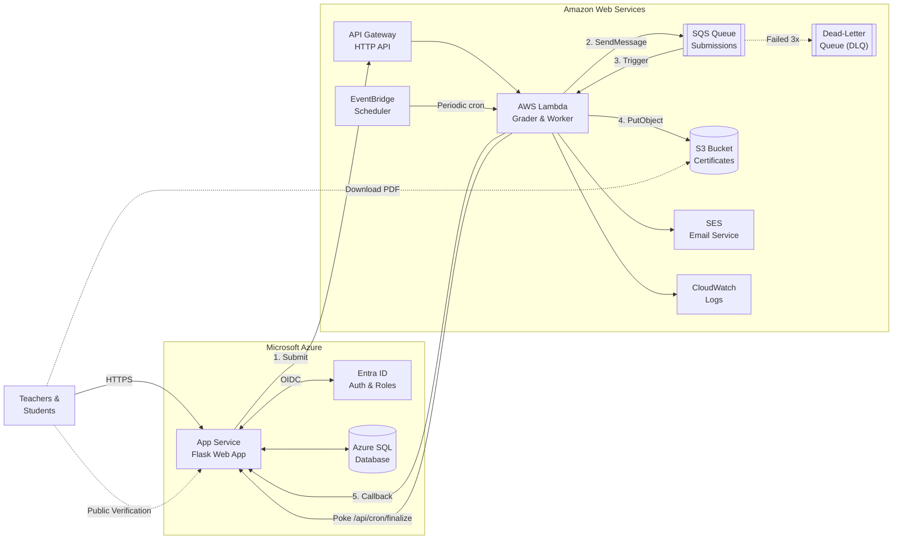

# QuizCloud: Multi-Cloud Online Quiz System (Azure + AWS)

A resilient online examination and quiz platform distributed across Microsoft Azure and Amazon Web Services (AWS). Teachers design exams with strict anti-cheating policies, students take timed tests, and background grading executes serverlessly.

When a student submits, the web app pushes the payload into **Amazon SQS**. An **AWS Lambda** worker grades the submission, renders a verified **PDF certificate**, stores it in a private **Amazon S3** bucket, and generates secure **presigned URLs**. User authentication and role-based access control (Teacher / Student) run on **Microsoft Entra External ID**, while transactional application state lives in **Azure SQL Database**. Recurring deadlines and attempt expirations are automatically triggered by **Amazon EventBridge Scheduler**.

> Run locally without any cloud account: check out [Local Demo](#running-the-demo-locally).

---

## Architecture



### Multi-Cloud Event-Driven Flow

1. **Submission Queueing:** The student submits their answers. The web app flags the attempt as `pending` in Azure SQL and forwards the payload to AWS API Gateway (`POST /grade` with `action: submit`).
2. **Instant Response:** Lambda verifies the shared secret, enqueues the payload into **Amazon SQS**, and returns `202 queued` immediately. The student sees a live status polling screen without waiting.
3. **Background Grading:** SQS triggers Lambda to grade answers and build the PDF certificate using `fpdf2` and Unicode DejaVu fonts.
4. **Certificate Storage:** Lambda stores the rendered PDF in a private **Amazon S3** bucket under `certificates/exam-<id>/submission-<id>-<code>.pdf`.
5. **Callback & Notification:** Lambda posts the final score and certificate metadata back to Azure Web (`POST /api/grader/callback`). Azure SQL saves the grade, and Lambda dispatches an email summary via **Amazon SES**.
6. **Automatic Deadline Finalization:** **Amazon EventBridge Scheduler** fires every 15 minutes, prompting Lambda to poke `/api/cron/finalize` on Azure Web to expire abandoned attempts and pick top scores.

---

## Core Capabilities

| Category | Features |
|---|---|
| **Anti-Cheating & Managed Exams** | Fullscreen enforcement, tab-switch (`blur`) detection, right-click and copy/paste prevention, real-time violation counter, student re-entry lock requiring teacher approval, and auto-submit on repeated infractions. |
| **Multi-Attempt & Versioning** | Configurable attempt limits (`max_attempts`), student attempt selection before deadline, automatic top-score pick via EventBridge cron, and immutable question snapshots (`ExamVersion`) ensuring edits never alter active attempts. |
| **Certificate Lifecycle & Verification** | Independent certificate records with unique alphanumeric codes, public verification portal at `/verify/<code>`, permanent revocation with public audit reason, retake tickets, and automatic SES notification emails. |
| **Teacher Administration** | Timed exam authoring, CSV question import, detailed question-level accuracy breakdown, printable HTML reports, CSV gradebook exports, and manual re-evaluation controls. |
| **Resilience & Security** | Asynchronous SQS processing with Dead-Letter Queue (DLQ), CSRF protection, strict row-level submission ownership, server-side countdown clock, and HMAC secret authorization between clouds. |

---

## Repository Structure

```
.
├── README.md
├── run_demo.bat / run_demo.command / run_demo.sh   # One-click local demo launcher
├── reset_demo.bat                                  # Wipe local SQLite data (Windows)
├── requirements-local.txt                          # Dependencies for local run
├── requirements-dev.txt                            # Dependencies for automated tests
├── web/                    # Flask app running on Azure App Service
│   ├── app.py              # Routes (teacher, student, managed mode, cron, callbacks)
│   ├── auth.py             # Microsoft Entra External ID (MSAL) & dev mock auth
│   ├── models.py           # Relational schema (exams, versions, submissions, events)
│   ├── grader_client.py    # Client calling AWS API Gateway
│   ├── config.py, demo_data.py, requirements.txt
│   ├── static/app.css      # Apple Cupertino design system stylesheet
│   └── templates/          # Jinja2 views (dashboard, take_exam, verify, attempts)
├── grader/                 # Serverless worker running on AWS Lambda
│   ├── handler.py          # Entry point for API Gateway, SQS, and EventBridge
│   ├── service.py, grading.py, certificate.py
│   ├── fonts/              # DejaVu fonts for UTF-8 PDF certificate rendering
│   ├── requirements.txt
│   └── build_zip.sh        # Packaging script generating grader.zip
└── tests/                  # 56 automated test cases covering web and grader logic
```

---

## Running the Demo Locally

Requires **Python 3.10+**. No cloud accounts required.

| Platform | Command / Action |
|---|---|
| **Windows** | Double-click `run_demo.bat` |
| **macOS** | Double-click `run_demo.command` or run `./run_demo.sh` |
| **Linux** | Run `./run_demo.sh` |

The launcher configures `.venv`, installs packages, generates sample quizzes and mock submissions, then launches `http://127.0.0.1:5000`. Use `reset_demo.bat` (or `./run_demo.sh --reset`) to start fresh.

Run the test suite locally:
```bash
pip install -r requirements-local.txt -r requirements-dev.txt
pytest -q
```

---

## Cloud Deployment & Interconnection Guide

Deploy services in geographically close regions to minimize cross-cloud latency:
- **Azure:** `Japan East` (`japaneast`) or `Southeast Asia`
- **AWS:** `ap-northeast-1` (Tokyo) or `ap-southeast-1` (Singapore)

```
┌────────────────────────────────────────────────────────────────────────┐
│                        MICROSOFT AZURE                                 │
│                                                                        │
│   ┌────────────────────┐                 ┌─────────────────────────┐   │
│   │  Microsoft Entra   │                 │   Azure SQL Database    │   │
│   │    External ID     │                 │   (Serverless Free)     │   │
│   └─────────┬──────────┘                 └────────────▲────────────┘   │
│             │ OIDC Auth                               │ DB Queries     │
│             ▼                                         │                │
│   ┌───────────────────────────────────────────────────┴────────────┐   │
│   │              Azure App Service (Web Application)               │   │
│   │          https://<your-web-app>.azurewebsites.net              │   │
│   └───────────────────────┬───────────────────────▲────────────────┘   │
└───────────────────────────┼───────────────────────┼────────────────────┘
                            │                       │
         POST /grade        │                       │ POST /api/grader/callback
         (Submit / Verify)  │                       │ POST /api/cron/finalize
                            ▼                       │
┌───────────────────────────────────────────────────┼────────────────────┐
│   ┌───────────────────────┴────────────┐          │                    │
│   │      AWS API Gateway (HTTP)        │          │                    │
│   └───────────────────────┬────────────┘          │                    │
│                           ▼                       │                    │
│   ┌───────────────────────────────────────────────┴────────────────┐   │
│   │                     AWS Lambda Function                        │   │
│   │                      (grader.zip worker)                       │   │
│   └──────┬────────────────▲────────────┬──────────────────┬────────┘   │
│          │ Enqueue        │ Trigger    │ PutObject        │ SendMail   │
│          ▼                │            ▼                  ▼            │
│   ┌──────────────┐        │     ┌──────────────┐   ┌───────────────┐   │
│   │  Amazon SQS  ├────────┘     │  Amazon S3   │   │  Amazon SES   │   │
│   │  (+ DLQ)     │              │  (Private)   │   │  (Email Svc)  │   │
│   └──────────────┘              └──────────────┘   └───────────────┘   │
│                                 AMAZON WEB SERVICES                    │
└────────────────────────────────────────────────────────────────────────┘
```

---

### Step 1: Azure Database & Authentication Setup

#### 1. Azure SQL Database
1. In the Azure Portal, create an **Azure SQL Database**.
2. Select **Apply free offer** (Serverless 32 GB free lifetime tier).
3. Under **Networking**, enable **Allow Azure services and resources to access this server** and add your client IP address.
4. Record your connection string:
   ```text
   mssql+pymssql://<db_user>:<db_password>@<server_name>.database.windows.net:1433/<db_name>
   ```
5. Initialize schema and sample tables from your development machine:
   ```bash
   cd web
   DATABASE_URL="mssql+pymssql://..." flask --app app init-db --demo
   ```

#### 2. Microsoft Entra External ID
1. In Microsoft Entra admin center, create an external tenant.
2. Under **App registrations**, register a new application.
3. Under **Authentication**, add a Web platform with Redirect URI:
   ```text
   https://<your-web-app>.azurewebsites.net/auth/callback
   ```
4. Under **Certificates & secrets**, generate a new client secret. Note the secret value.
5. Under **App roles**, declare two user-assignable roles: `Teacher` and `Student`.
6. Authority URL format: `https://<tenant-subdomain>.ciamlogin.com/<tenant-subdomain>.onmicrosoft.com`

---

### Step 2: AWS Backend Infrastructure Setup

#### 1. S3 Storage & SQS Messaging
1. **S3 Bucket:** Create a private bucket (e.g. `quizcloud-certs-<group>`). Keep *Block all public access* turned on.
2. **SQS Queues:** Create two standard queues:
   - `quizcloud-grading-dlq` (default settings).
   - `quizcloud-grading`: Visibility timeout = **180 seconds**. Enable dead-letter queue, link `quizcloud-grading-dlq`, set *Maximum receives* to **3**. Note the queue URL and ARN.

#### 2. IAM Role for Lambda
Attach AWS managed policies `AWSLambdaBasicExecutionRole` and `AWSLambdaSQSQueueExecutionRole`. Add an inline policy:
```json
{
  "Version": "2012-10-17",
  "Statement": [
    {"Effect": "Allow", "Action": ["s3:PutObject", "s3:GetObject"], "Resource": "arn:aws:s3:::<BUCKET>/certificates/*"},
    {"Effect": "Allow", "Action": "sqs:SendMessage", "Resource": "<ARN_OF_QUIZCLOUD_GRADING>"},
    {"Effect": "Allow", "Action": "ses:SendEmail", "Resource": "*"}
  ]
}
```

#### 3. Lambda Deployment
1. On your machine, package `grader/` into `grader.zip`:
   ```bash
   cd grader
   ./build_zip.sh
   ```
2. Create an AWS Lambda function with runtime **Python 3.12 (x86_64)**.
3. Handler: `handler.lambda_handler`, Memory: 512 MB, Timeout: 30 seconds. Upload `grader.zip`.
4. Configure Environment Variables:

   | Variable | Value |
   |---|---|
   | `CERT_BUCKET` | Your S3 bucket name |
   | `GRADER_SECRET` | Strong random shared secret string |
   | `GRADING_QUEUE_URL` | URL of `quizcloud-grading` |
   | `WEB_CALLBACK_URL` | `https://<your-web-app>.azurewebsites.net/api/grader/callback` |
   | `WEB_CRON_URL` | `https://<your-web-app>.azurewebsites.net/api/cron/finalize` |
   | `SES_SENDER` | (Optional) Verified sender email address |
   | `PRESIGN_TTL_SECONDS` | `3600` |

5. Add an **SQS Trigger** pointing to `quizcloud-grading` with **Batch size = 1**.

#### 4. API Gateway
1. Create an **HTTP API** in API Gateway.
2. Add route `POST /grade` integrated with your Lambda function.
3. The resulting endpoint URL (e.g. `https://xxxx.execute-api.ap-northeast-1.amazonaws.com/grade`) is your `GRADER_URL`.

#### 5. EventBridge Scheduler (Auto-finalize cron)
1. In Amazon EventBridge, navigate to **Schedules** -> **Create schedule**.
2. Name: `quizcloud-finalize-cron`.
3. Schedule pattern: **Recurring schedule** -> **Rate-based schedule** -> `rate(15 minutes)`.
4. Target: Select **AWS Lambda** -> pick your function.

---

### Step 3: Wiring Everything into Azure App Service

With your Azure App Service created, complete the end-to-end integration:

#### 1. Configure Startup Command
1. In the Azure Portal, open your App Service.
2. Go to **Settings** -> **Configuration** (or **Configuration** tab) -> **General settings**.
3. Under **Startup Command**, set:
   ```bash
   gunicorn --bind=0.0.0.0 --timeout 120 app:app
   ```
4. Click **Save**.

#### 2. Connect Repository (Automated CI/CD)
1. Under **Deployment**, open **Deployment Center**.
2. Select **Source:** `GitHub`.
3. Select your organization `Phong02032006`, repository `project_cloud`, branch `main`.
4. Click **Save**. Azure automatically pulls the latest commit and runs the build.

#### 3. Set Environment Variables
Go to **Settings** -> **Environment variables** in your App Service and supply the values gathered from AWS and Azure:

| Name | Description / Source |
|---|---|
| `SECRET_KEY` | Long random session secret string |
| `DATABASE_URL` | Azure SQL connection string (`mssql+pymssql://...`) |
| `AUTH_MODE` | Set `dev` initially for testing, then switch to `entra` |
| `ENTRA_CLIENT_ID` | Application (client) ID from Entra registration |
| `ENTRA_CLIENT_SECRET` | Client secret value from Entra registration |
| `ENTRA_AUTHORITY` | Entra tenant authority URL |
| `GRADER_URL` | AWS API Gateway endpoint URL |
| `GRADER_SECRET` | Shared secret matching Lambda `GRADER_SECRET` |
| `GRADER_ASYNC` | `true` (enables asynchronous SQS queue processing) |
| `SCM_DO_BUILD_DURING_DEPLOYMENT` | `true` |

Click **Apply**. Your application is now fully linked and live across both clouds.

---

## Grader API Specification

Requests sent to `POST GRADER_URL` must include the `x-grader-secret` header.

| Action | Extra Body Parameters | Response |
|---|---|---|
| `submit` | Submission payload | `202 {"status": "queued", "message_id": "..."}` |
| `grade` | Submission payload | `200` with score and `certificate_url` (synchronous) |
| `presign` | `certificate_key` | `{"certificate_url": "..."}` |
| `notify` | `kind`, `student`, `exam_title`, `extra` | `200 {"status": "sent"}` (dispatches SES notice) |

---

## 10 Cloud Services Summary

- **Microsoft Azure (3 services):**
  1. *Azure App Service:* Linux PaaS hosting the core web application.
  2. *Azure SQL Database:* Serverless relational database with ACID guarantees.
  3. *Microsoft Entra External ID:* Enterprise identity provider with App Roles.
- **Amazon Web Services (7 services):**
  4. *Amazon API Gateway:* Cross-cloud HTTP API ingestion point.
  5. *AWS Lambda:* Serverless worker for grading and document rendering.
  6. *Amazon SQS:* Asynchronous message queue with Dead-Letter Queue (DLQ).
  7. *Amazon S3:* Secure private object store for generated certificates.
  8. *Amazon SES:* Transactional email delivery service.
  9. *Amazon CloudWatch:* Centralized audit logging and telemetry.
  10. *Amazon EventBridge Scheduler:* Periodic task runner for attempt expiration.
